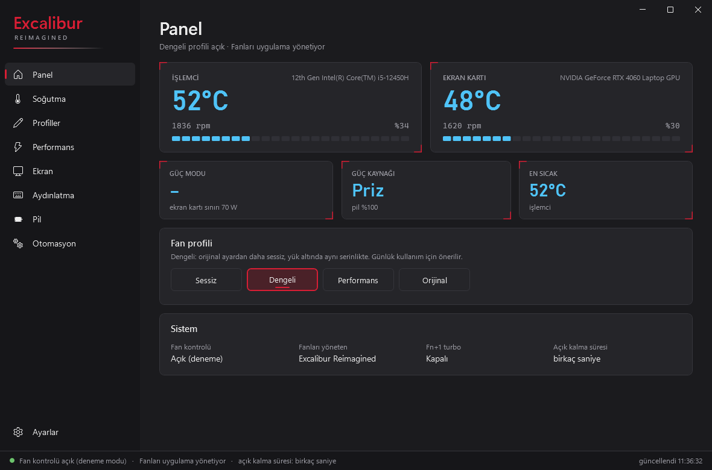
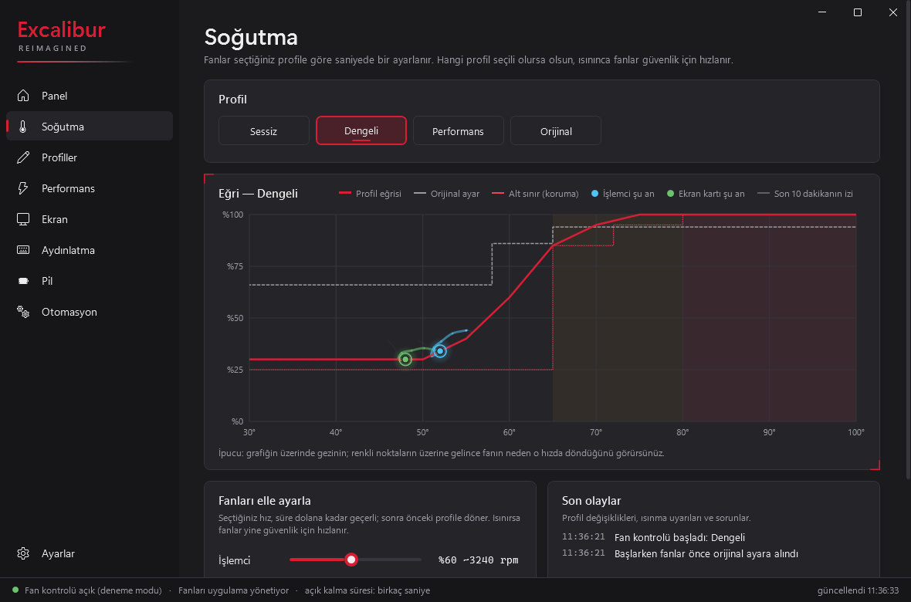
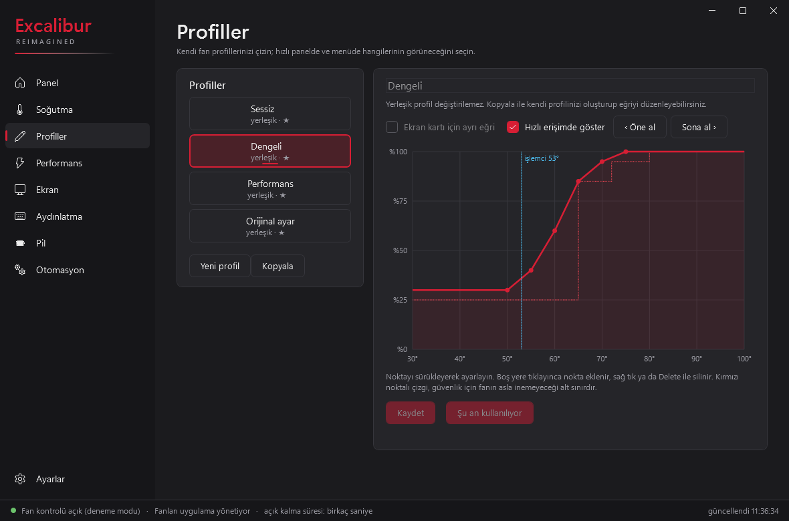
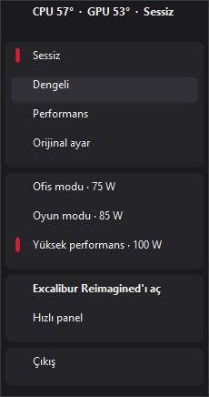

<div align="center">


# Excalibur Reimagined

**Casper Excalibur G870 için hafif, hızlı ve açık kaynaklı Control Center alternatifi.**

[](#)
[](#)
[](LICENSE)

[Özellikler](#özellikler) • [Kurulum](#kurulum) • [Teknik Detaylar](#teknik-detaylar-ve-güvenlik) • [English](#english)

</div>

> [!WARNING]
> **⚠️ Erken Erişim (Early Access)**
> Bu uygulama, dizüstü bilgisayarınızın gömülü denetleyicisine (EC) doğrudan yazar. Yalnızca **Casper Excalibur G870 (EC sürümü `P008B0`, BIOS CQ141)** üzerinde test edilmiştir. Farklı bir model veya EC sürümünde fanları **kontrol etmez**, yalnızca izler. 
> *Kullanım tamamen sizin sorumluluğunuzdadır. Bu projenin Casper veya Excalibur markasıyla resmî bir bağı yoktur.*

## 💡 Neden Excalibur Reimagined?

Orijinal Excalibur Control Center bazen yavaş açılır, arka planda gereksiz kaynak tüketir veya fan eğrilerini tam olarak yansıtmaz. **Excalibur Reimagined**, donanım katmanıyla doğrudan iletişim kurarak fanları ve güç modlarını pürüzsüzce yönetir. İnternete bağlanmaz, veri toplamaz, arka planda sessizce işini yapar.

<p align="center">
  
  
</p>
<p align="center">
  
  
</p>
<sub>*Ekran görüntüleri uygulamanın deneme modundan alınmıştır.*</sub>

## ✨ Özellikler

- 🌀 **Gelişmiş Fan Kontrolü:** Sessiz, Dengeli ve Performans profilleri. İşlemci (CPU) ve ekran kartı (GPU) fanlarını ayrı ayrı yönetme imkânı.
- 📈 **Özel Fan Eğrileri:** Kendi profilinizi oluşturun, grafik üzerinde noktaları sürükleyerek istediğiniz sıcaklığa istediğiniz fan hızını atayın.
- ⚡ **Güç ve Performans Modları:** Ofis (75 W), Oyun (85 W) ve Yüksek Performans (100 W) limitleriyle donanımınızın gücünü belirleyin.
- 🔌 **Akıllı Otomasyon:** Şarj kablosu takıldığında veya çıkarıldığında belirlediğiniz güç modu, fan profili ve ekran yenileme hızı (Hz) otomatik olarak devreye girer.
- 📊 **Geçmiş ve İzleme:** Görev çubuğunda canlı sıcaklık takibi, hızlı kontrol paneli, ekran bildirimleri (OSD) ve bilgisayarınızda tutulan 7 günlük sıcaklık/fan geçmişi.

> **🛠️ Planlanan Özellikler:** Klavye ışığı kontrolü, pil şarj sınırı koyma, uygulamaya/oyuna özel otomatik profiller, klavye kısayolları ve İngilizce dil seçeneği.

---

## 🚀 Kurulum

Henüz tek tıklamalı bir kurulum dosyası (`.exe`) bulunmamaktadır. Kurulumu kod üzerinden birkaç saniyede yapabilirsiniz:

### Gereksinimler
- Windows 11 ve Casper Excalibur G870
- [.NET 9 Runtime ve Windows Desktop Runtime](https://dotnet.microsoft.com/download/dotnet/9.0)
- [PawnIO](https://pawnio.eu) sürücüsü: Fan servisinin donanıma (EC) güvenle erişmesini sağlayan, imzalı bir sürücüdür. Kurulum betiği PawnIO'yu **kendisi kurmaz**; yoksa kurulumu durdurur. Önce yönetici PowerShell'de şunu çalıştırın (ya da resmî siteden indirip kurun):

```powershell
winget install namazso.PawnIO
```

### Adımlar

1. Başlat menüsüne sağ tıklayıp **Terminal (Yönetici)** veya **PowerShell (Yönetici)** seçeneğini açın.
2. Aşağıdaki komutları sırasıyla kopyalayıp yapıştırın ve Enter'a basın:

```powershell
# 1. Projeyi bilgisayarınıza indirin
git clone https://github.com/soldsawn/ExcaliburReimagined.git
cd ExcaliburReimagined

# 2. PawnIO'nun EC modülünü (LpcACPIEC.bin) indirin (sürücü değil, doğrulanarak indirilen küçük bir dosya)
powershell -ExecutionPolicy Bypass -File tools\scripts\get-pawnio-module.ps1

# 3. Servisleri kurun ve başlatın
powershell -ExecutionPolicy Bypass -File tools\scripts\install-fan.ps1
```

> **PawnIO sorun giderme:** Kurulum "PawnIO is not installed" hatası verirse yukarıdaki `winget` komutunu çalıştırıp kurulumu yeniden başlatın. Servis "needs administrator rights (PawnIO)" derse yönetici olarak çalıştırılmamıştır; kurulum servisleri zaten yönetici (SYSTEM) hesabıyla kurar.

> **Not:** Kurulum, eğer sisteminizde eski bir NoteBook FanControl (`NbfcService`) varsa çakışmayı önlemek için onu geçici olarak devre dışı bırakır. Kaldırma işleminde eski hâline geri döndürür. Uygulamayı kaldırmak isterseniz aynı klasörde `powershell -ExecutionPolicy Bypass -File tools\scripts\uninstall-fan.ps1` komutunu çalıştırmanız yeterlidir.

---

## ⚙️ Teknik Detaylar ve Güvenlik (Geliştiriciler İçin)

Fan kontrolü riskli bir işlemdir. Bu yüzden sistem, donanımınızı korumak için katı kurallarla tasarlandı:

### Güvenlik Tasarımı
- **Donanımsal Alt Sınırlar:** Fan hızı asla %25'in altına inemez.
- **Isı Kalkanı:** Profiliniz ne olursa olsun; sıcaklık 65°C'yi geçerse fanlar en az %80, 72°C'yi geçerse en az %90 hızda çalışır. Eğer CPU veya GPU 80°C'nin üstünde 3 saniye kalırsa sistem güvenliği için fanlar anında **%100**'e kilitlenir.
- **Bekçi (Guardian) Servisi:** Ana fan servisi çöker veya kilitlenirse, yedek servis anında müdahale ederek fan kontrolünü dizüstü bilgisayarın orijinal yazılımına (EC Otomatik) geri devreder.
- **Hata Toleransı:** EC (Embedded Controller) okuması doğrulanamazsa, bilgisayar uyku moduna geçerse veya uygulamadan "Çıkış" yaparsanız kontrol tamamen orijinal donanım ayarlarına bırakılır. Eğer bilgisayar kilitlenirse, güç tuşuna 15-30 saniye basılı tutmak EC'yi sıfırlar.

### Mimari Nasıl Çalışıyor?
Uygulama 3 ana bileşenden oluşur:
1. `ExcaliburFan` *(Hizmet)*: Arka planda donanıma PawnIO üzerinden erişen, fan döngülerini ve güvenlik kurallarını işleten çekirdek servis.
2. `ExcaliburFanGuardian` *(Hizmet)*: Çekirdek servisi izleyen gözetmen.
3. `ExcaliburReimagined.exe` *(Arayüz)*: Sadece bir kontrolcüdür. Donanıma dokunmaz, yerel adlandırılmış boru (named pipe) üzerinden servise komut gönderir.

Geliştiriciler, test yapmak için donanıma dokunmayan simülasyon modunu kullanabilir: `ExcaliburFanService.exe --simulate`

## 🤝 Katkıda Bulunma
Başka bir donanım modelinde veya BIOS sürümünde test etmek isterseniz, lütfen bir **Issue** açarak EC ve BIOS sürümünüzü belirtin. Okuma/yazma doğrulaması yapılmadan yeni cihazlar için fan kontrolü kilidi açılmaz.

## 📄 Lisans ve Sorumluluk Reddi
[MIT Lisansı](LICENSE) ile sunulmaktadır. (Donanım erişimi için kurulan PawnIO modülleri LGPL-2.1 lisanslıdır ve resmi kaynaktan çekilir). Donanım bileşenlerine yapılan müdahaleler cihazı garanti dışı bırakabilir veya ısınma sorunlarına yol açabilir. Kullanımdan doğacak tüm sorumluluk kullanıcıya aittir.

---

<a id="english"></a>
## 🇬🇧 Excalibur Reimagined (English)

A lightweight, open-source, and bloat-free replacement for Casper's Excalibur Control Center, built specifically for the **Casper Excalibur G870** laptop (Windows 11).

> [!WARNING]
> **Early access (`v0.1.1`).** This application writes directly to the laptop's embedded controller (EC). It has only been tested on **EC version `P008B0`, BIOS CQ141**. On unknown versions, it acts in monitor-only mode. Use at your own risk.

**Features:**
- Custom fan curves with separate CPU/GPU targets.
- Hardware power modes (75W / 85W / 100W GPU limits).
- Smart automation based on AC/Battery status (auto-switch profiles and refresh rates).
- Zero telemetry, low background resource usage, and local temperature history.

**Safety First:**
Hardcoded limits ensure fans never go below 25%. Automatic overrides kick in at 65°C (80% fan), 72°C (90% fan), and force 100% fan speed if temps exceed 80°C for 3 seconds. A background "Guardian" service constantly monitors the main process; if it crashes, fan control is immediately returned to the factory BIOS.

**Installation (Elevated PowerShell):**
```powershell
winget install namazso.PawnIO   # the PawnIO driver (https://pawnio.eu); the installer below does not install it
powershell -ExecutionPolicy Bypass -File tools\scripts\get-pawnio-module.ps1
powershell -ExecutionPolicy Bypass -File tools\scripts\install-fan.ps1
```
*(Requires the .NET 9 Runtimes and the PawnIO driver. `get-pawnio-module.ps1` only downloads the small EC module, not the driver itself.)*
