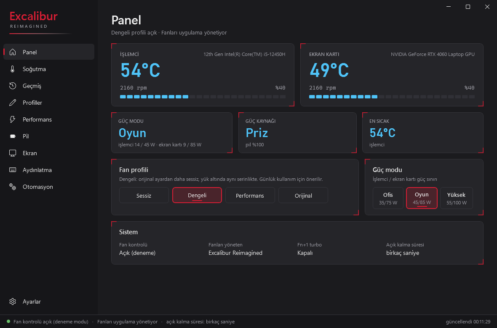
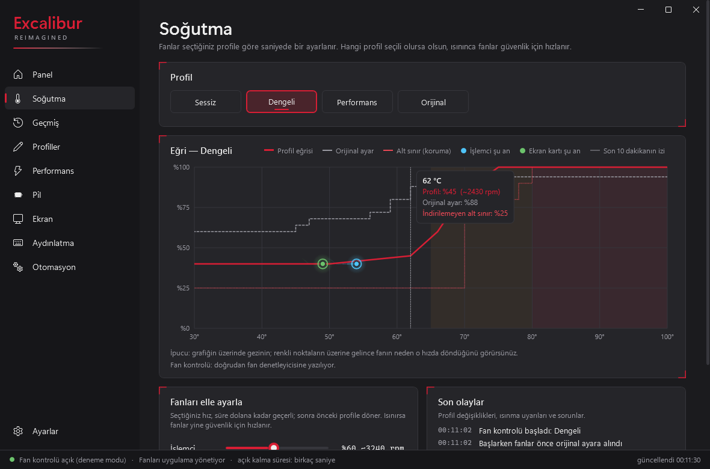
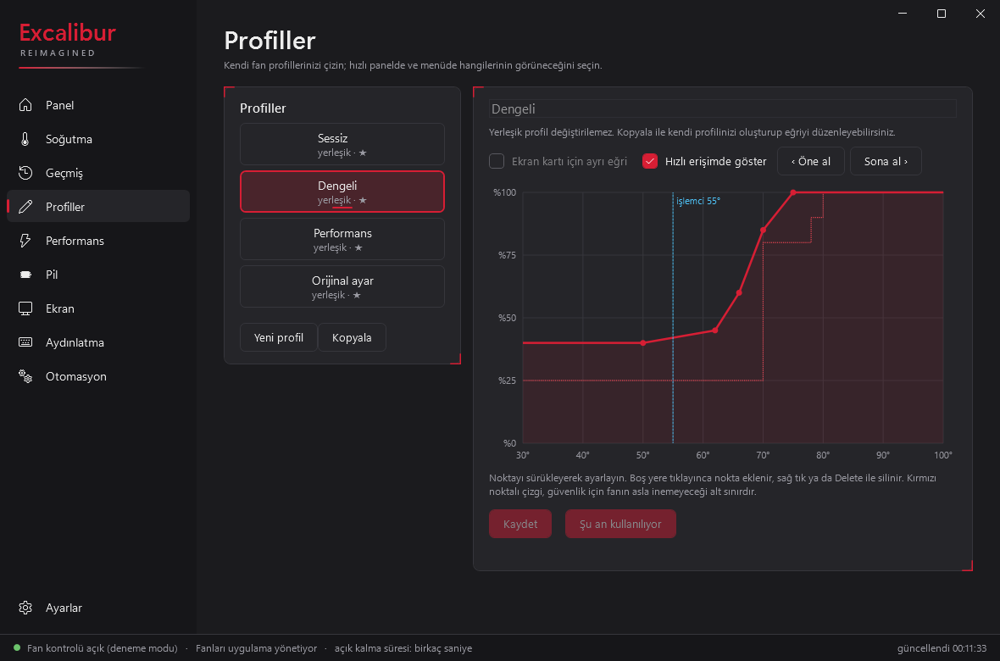
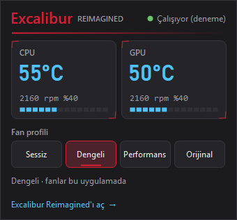
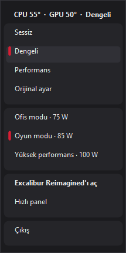
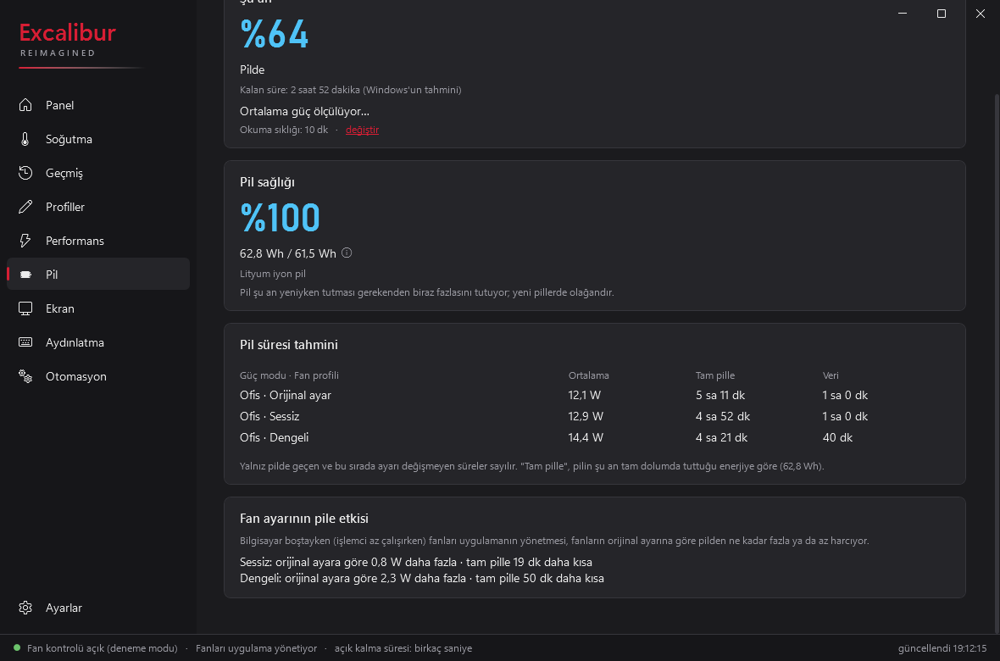
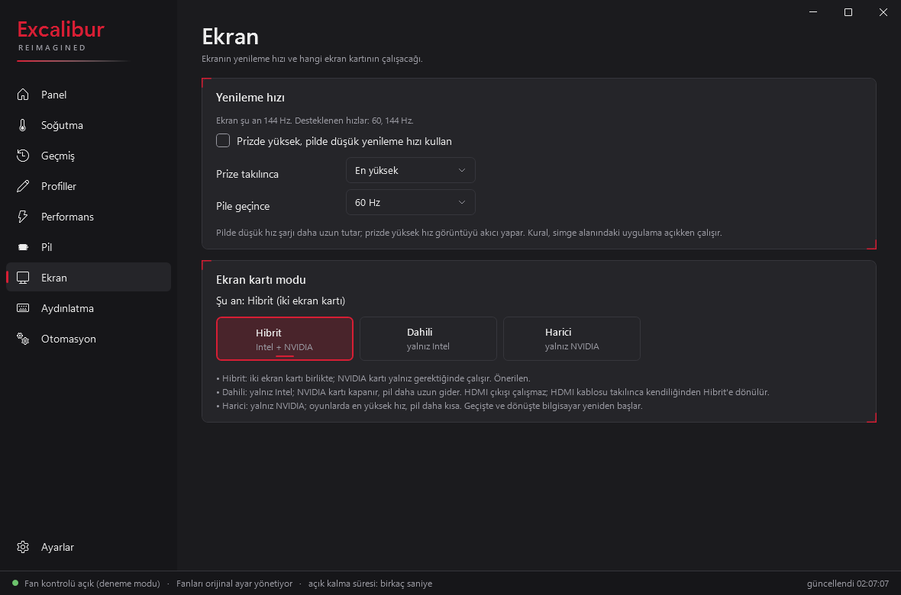
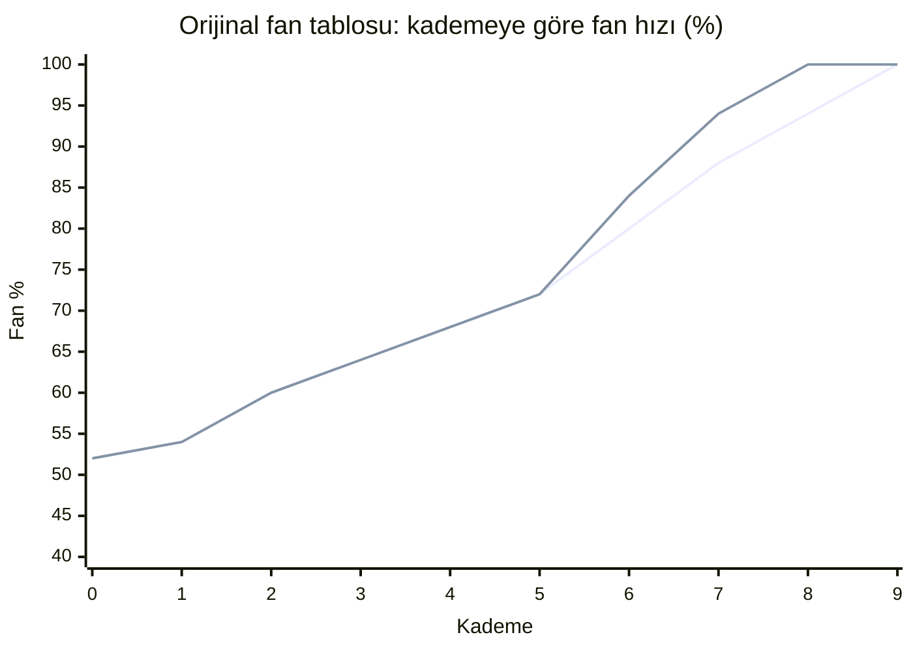

<div align="center">


# Excalibur Reimagined

**Casper Excalibur G870 için hafif, hızlı ve açık kaynaklı Control Center alternatifi.**

[](https://github.com/soldsawn/ExcaliburReimagined/releases/latest)
[](#)
[](LICENSE)

[Özellikler](#özellikler) • [Kurulum](#kurulum) • [Linux](#linux) • [Teknik Detaylar](#teknik-detaylar-ve-güvenlik) • [BIOS Bulguları](#bios) • [English](#english)

</div>

> [!WARNING]
> **⚠️ Dikkat**
> Bu uygulama, dizüstü bilgisayarınızın gömülü denetleyicisine (EC) doğrudan yazar. Asıl olarak **Casper Excalibur G870 (EC sürümü `P008B0`, BIOS CQ141)** üzerinde geliştirilip test edilmiştir. Farklı bir model veya EC sürümünde fanları önce yalnızca **izler**; fan kontrolü ancak sizin onayınızla yapılan kısa bir denemeden geçerse açılır (bkz. [Diğer modeller](#diğer-modeller)). 
> *Kullanım tamamen sizin sorumluluğunuzdadır. Bu projenin Casper veya Excalibur markasıyla resmî bir bağı yoktur.*

## 💡 Neden Excalibur Reimagined?

Orijinal Excalibur Control Center bazen yavaş açılır, arka planda gereksiz kaynak tüketir veya fan eğrilerini tam olarak yansıtmaz. **Excalibur Reimagined**, donanım katmanıyla doğrudan iletişim kurarak fanları ve güç modlarını pürüzsüzce yönetir. Kendiliğinden internete bağlanmaz, veri toplamaz, arka planda sessizce işini yapar.

<p align="center">
  
  
</p>
<p align="center">
  
  
  
</p>
<p align="center">
  
  
</p>
<sub>*Ekran görüntüleri uygulamanın deneme modundan alınmıştır; Pil sayfasındaki ölçümler örnek veridir.*</sub>

<a id="özellikler"></a>
## ✨ Özellikler

- 🌀 **Gelişmiş Fan Kontrolü:** Sessiz, Dengeli ve Performans profilleri. İşlemci (CPU) ve ekran kartı (GPU) fanlarını ayrı ayrı yönetme imkânı.
- 📈 **Özel Fan Eğrileri:** Kendi profilinizi oluşturun, grafik üzerinde noktaları sürükleyerek istediğiniz sıcaklığa istediğiniz fan hızını atayın.
- ⚡ **Güç ve Performans Modları:** Ofis, Oyun ve Yüksek Performans modlarıyla donanımınızın gücünü belirleyin; Panel'de fan profilinin hemen yanında. Her modun işlemci ve ekran kartı sınırı sizin bilgisayarınızda ölçülerek gösterilir (G870'te Ofis 35/75 W, Oyun 45/85 W, Yüksek Performans 55/100 W). İsterseniz her mod (ve pil) için Windows güç planı ve Windows güç modu da birlikte değişir (Ayarlar, varsayılan kapalı).
- 🔥 **İşlemci ve Ekran Kartı Güç Sınırı:** İşlemcinin uzun ve kısa süreli güç sınırını, ekran kartının da en yüksek gücünü (30 W'tan güç modunun sınırına kadar) güç modunun altına indirerek daha serin ve sessiz çalışma. Ekran kartı sınırı, kartın hızı birkaç saniyede bir ayarlanarak tutulur (G870'te 1500 MHz'de oyun 100 W yerine 40 W çekti, kart 82 °C yerine 62 °C'de kaldı). Performans sayfasında işlemcinin ve ekran kartının anlık çektiği güç de görünür.
- 🔋 **Pil Sayfası:** Pil sağlığı (tam dolum / ilk günkü kapasite), şarj durumu ve kalan süre; pildeyken son dakikaların ortalama tüketimi; güç modu ve fan profiline göre "tam pille ne kadar gider" tablosu ve fan ayarının pile etkisi. Pil, denetleyiciye yük olmasın diye seyrek okunur (varsayılan 10 dakikada bir, şarjdayken hiç); kayıtlar bilgisayarınızda 30 gün tutulur.
- ⌨️ **Klavye Işığı:** Üç bölge için renk, parlaklık ve efekt; belirli bir süre boşta kalınca ışığı kapatma. Klavyedeki ışık tuşuyla yapılan değişiklikler de izlenir.
- 🔌 **Akıllı Otomasyon:** Şarj kablosu takıldığında veya çıkarıldığında belirlediğiniz güç modu, fan profili ve ekran yenileme hızı (Hz) otomatik olarak devreye girer.
- 🎮 **Program Kuralları:** Seçtiğiniz bir program ya da oyun açıkken kendi fan profili, güç modu ve işlemci sınırı devreye girer; kapanınca önceki ayarlar geri gelir.
- 📊 **Geçmiş ve İzleme:** Görev çubuğunda canlı sıcaklık takibi, hızlı kontrol paneli, ekran bildirimleri (OSD) ve bilgisayarınızda tutulan sıcaklık/fan geçmişi (7 ya da 30 gün; 15 dakikadan 7 güne kadar aralıklar).
- 🎨 **Görünüm:** Koyu/açık tema , 8 hazır vurgu rengi ya da dilediğiniz renk, büyük sayıların ve tepsi simgesinin yazı tipi, kart köşe çizgileri ve grafikteki hareket.
- 🔄 **Güncelleme Denetimi:** GitHub'da yeni sürüm olup olmadığı kontrolü.
- 🧹 **Casper Programlarını Kapatma:** Control Center'ın arka planda çalışan sürücüsü, açılış görevleri ve programları tek tuşla durdurulup devre dışı bırakılır; hiçbir şey silinmez, "Geri al" eski hâline döndürür (Ayarlar). Fan denetleyicisini kullanan başka programlar (NoteBook FanControl, WinRing0) uyarı olarak gösterilir.
- ⌨️ **Kısayol Tuşları:** Her yerden fan profilini (Ctrl+Alt+F) ve güç modunu (Ctrl+Alt+M) değiştirme, pencereyi açma (Ctrl+Alt+E); birleşimler Ayarlar'dan değiştirilebilir.
- 🖥️ **Ekran Kartı Modu:** Hibrit (Intel + NVIDIA), Dahili (yalnız Intel; NVIDIA kartı kapanır, pil daha uzun gider) ve Harici (yalnız NVIDIA; dizüstünün ekran anahtarıyla dahili ekran da NVIDIA'ya geçer). Hibrit ile Dahili arasında yeniden başlatma gerekmez; HDMI kablosu takılıyken Dahili'ye geçilmez (HDMI çıkışı NVIDIA'ya bağlı), Dahili'deyken kablo takılınca kendiliğinden Hibrit'e dönülür. Harici'ye geçiş ve dönüş bilgisayarı yeniden başlatır; BIOS ekranı taşırken bu açılış 1-2 dakika sürer, bilgisayar bir kez kapanıp açılabilir. BitLocker açıkken Harici'ye geçilmez. Yöntem orijinal Control Center'ın bu modeldekiyle aynıdır (Ekran sayfası).
> **🛠️ Planlanan Özellikler:** İngilizce dil seçeneği; Linux'ta Secure Boot açıkken çalışma ve güç modunun ekran kartı sınırını da değiştirmesi (kendi çekirdek modülümüzle).

<a id="diğer-modeller"></a>
### 🧪 Diğer Modeller ve EC Sürümleri

**Denenen cihazlar:**

| Model | BIOS | Fan yazılımı (EC) | Sonuç | Fanlar nasıl yönetiliyor | Uygulamadaki destek |
|---|---|---|---|---|---|
| Casper Excalibur G870 | CQ141 | `P008B0` | Geliştirildiği cihaz, tüm özellikler | doğrudan EC | ✅ Doğrulanmış |
| Casper Excalibur G870 | CQ171 / CQ212 | `P009B0` | Deneme geçti, iki fan da uydu | doğrudan EC | ✅ Doğrulanmış |
| Casper Excalibur G870 | CQ111 | `P006B0` | İki ayrı cihazda deneme geçti, iki fan da uydu | doğrudan EC | ✅ Doğrulanmış |
| Casper Excalibur G870 | CP211 | `P009C0` | Deneme geçti, iki fan da uydu | BIOS fan komutu (WMI) | ⚡ Tek tıkla kısa ayar |
| Casper Excalibur G870 | CQ131 | `P007B0` | Deneme geçti, iki fan da uydu | doğrudan EC | ⚡ Tek tıkla kısa ayar |
| Casper Excalibur G770 | CP221 | `P003K0` | Deneme geçti, iki fan da uydu | doğrudan EC | ⚡ Tek tıkla kısa ayar |

Listede olmayan bir cihazda denediyseniz sonucu bir **Issue** ile paylaşabilirsiniz (bkz. [Katkıda Bulunma](#katkıda-bulunma)). Uygulamada **Ayarlar > Hakkında > "Bilgileri kopyala"** gerekli bilgileri tek satırda verir.

**Uygulama fan yazılımı (EC) sürümünü nasıl ele alır:**

| Grup | Sürümler | Açılışta | Deneme geçtikten sonra |
|---|---|---|---|
| ✅ **Doğrulanmış** | `P008B0`, `P009B0`, `P006B0` | Deneme yok, fan kontrolü hemen başlar. | — |
| ⚡ **Başka cihazda çalışmış** | `P009C0`, `P007B0`, `P003K0` | Fanlar yalnız izlenir; Panel'de tek tıkla kısa bir ayar önerilir. | G870 sürümleri seçili profille, G770 dizüstünün kendi fan ayarıyla devam eder. |
| ❔ **Bilinmeyen** | Listede olmayan her sürüm | Fanlar yalnız izlenir; Panel'de onay isteyen kısa bir deneme önerilir. | Dizüstünün kendi fan ayarıyla (Orijinal) başlar; Soğutma sayfasından bir profil seçebilirsiniz. |

- **Deneme nasıl çalışır:** Uygulama fanlara kısa süre bir hız yazar ve fanların gerçekten uyup uymadığına bakar. Önce BIOS'un kendi fan komutu (WMI) denenir; fanlar buna uyarsa o bilgisayarda fanlar hep BIOS üzerinden yönetilir ve denetleyiciye (EC) doğrudan hiç yazılmaz. Uymazsa doğrudan EC denenir. İkisi de olmazsa fanlar hemen dizüstünün kendi ayarına bırakılır. Hangi yolun kullanıldığı Soğutma sayfasında ve Ayarlar > Hakkında'da yazar.
- **Deneme bir kez yapılır.** Geçtikten sonra o bilgisayarda her açılışta denemesiz başlar ve en son seçtiğiniz profil kullanılır.
- Her fanın yüzde başına devri kullanım sırasında öğrenilir. G870 fan eğrileri başka modellerde gereğinden gürültülü olabilir; bu yüzden G870 dışındaki modeller deneme sonrası dizüstünün kendi fan ayarıyla başlar.

---
<a id="kurulum"></a>
## 🚀 Kurulum

### Kolay yol: kurulum dosyası

1. [Son sürüm](https://github.com/soldsawn/ExcaliburReimagined/releases/latest) sayfasından **`ExcaliburReimagined-<sürüm>-setup.exe`** dosyasını indirip çalıştırın.
2. Kurulum her şeyi kendisi yapar: .NET dosyanın içinde gelir; [PawnIO](https://pawnio.eu) sürücüsü kurulu değilse resmî dosyasını indirir, doğrular ve kurar. Bittiğinde simge saatin yanında, pencere Başlat menüsündedir.
3. Kaldırmak için: **Ayarlar > Uygulamalar > Excalibur Reimagined > Kaldır**. Ayarlarınızın ve fan geçmişinin silinip silinmeyeceği sorulur (varsayılan: saklanır).

> **Windows uyarısı:** Kurulum dosyası imzalı olmadığı için Windows "bilinmeyen yayımcı" diyebilir. **Ek bilgi > Yine de çalıştır** ile devam edebilirsiniz.

Sürüm sayfasında ayrıca **`ExcaliburReimagined-<sürüm>-zip-kurulum.zip`** de vardır: zip'i bir klasöre çıkarıp `1-Kur.cmd` ile kurar, `2-Kaldir.cmd` ile kaldırırsınız (kurulum dosyasıyla aynı işi yapar).

<a id="linux"></a>
### 🐧 Linux

> Linux paketleri şimdilik **[v0.2.0](https://github.com/soldsawn/ExcaliburReimagined/releases/tag/v0.2.0)** sürüm sayfasındadır; v0.2.1 yalnız Windows için.

Linux sürümü arka plan servisi, **Windows'takiyle aynı pencere** (Panel, Soğutma, Geçmiş, Profiller, Performans, Pil, Aydınlatma, Otomasyon, Ayarlar; masaüstü destekliyorsa sistem tepsisi simgesi) ve komut satırından (`exr`) oluşur: aynı fan profilleri ve özel eğriler, aynı güvenlik kuralları ve EC sürüm denemesi, güç modları (pilde otomatik Ofis kilidi), işlemci/ekran kartı watt sınırları, şarja/pile göre otomatik geçiş, üç bölgeli klavye ışığı, pil sağlığı/tahminleri ve yerel geçmiş. Servis durunca, çökünce ya da bilgisayar uykuya geçince fanlar dizüstünün kendi ayarına döner; servis durunca watt sınırları da geri alınır.

**Şart:** BIOS'ta **Secure Boot kapalı** olmalı (açılışta F2 > Security). Açıkken Linux EC'ye yazmaya izin vermez; uygulama bunu söyler ve fanlara dokunmaz.

**Ubuntu, Linux Mint, Pop!_OS, Zorin, Debian:** sürüm sayfasından **`excalibur-reimagined_<sürüm>_amd64.deb`** dosyasını indirip çift tıklayın ya da:

```bash
sudo apt install ./excalibur-reimagined_*_amd64.deb
```

Kaldırmak için `sudo apt remove excalibur-reimagined` (ayarlar ve geçmiş de silinsin: `sudo apt purge excalibur-reimagined`). Daha önce `install.sh` ile kurduysanız `.deb` eskisini kendisi temizler.

**Diğer dağıtımlar:** **`ExcaliburReimagined-<sürüm>-linux-x64.tar.gz`**:

```bash
tar -xzf ExcaliburReimagined-*-linux-x64.tar.gz
cd ExcaliburReimagined-*-linux-x64
sudo bash install.sh
```

| Komut | Ne yapar |
|---|---|
| `exr` veya `exr gui` | Pencereli masaüstü arayüzünü ve sistem tepsisi (saatin yanındaki) simgesini açar |
| `exr status` | Sıcaklıklar, fan yüzdeleri/devirleri, profil, güç modu ve watt sınırları |
| `exr profile sessiz` | Profil değiştirir (`dengeli`, `performans`, `orijinal`, `<özel-ad>`); yeniden başlatmada korunur |
| `exr profiles` / `exr profile save Gece 45:25,60:40,75:80` | Tüm profilleri listeler, özel fan eğrisi kaydeder veya siler (`delete`) |
| `exr manual 60` | Fanları geçici olarak (1–10 dk) sabit yüzdede tutar |
| `exr mode oyun` | Güç modunu değiştirir (`ofis`, `oyun`, `yuksek`; pilde yalnız Ofis) |
| `exr cpu-limit 35 60` / `exr gpu-limit 65` | İşlemci (PL1/PL2) ve ekran kartı watt sınırları (`off` ile kaldırılır) |
| `exr auto ac mode oyun profile dengeli` | Şarja takılınca / pile geçince (`bat`) otomatik güç modu ve fan profili |
| `exr light #00FFFF --level 2` | Klavye rengi, parlaklığı (0–2) ve efektleri (`breathing`, `cycle`, `zones`, `off`) |
| `exr battery` / `exr history 60` | Pil sağlığı, süre tahminleri ve son dakikaların fan/sıcaklık özeti |
| `exr trial` | Tanınmayan EC sürümünde onaylı kısa deneme |
| `exr report` | Sorun bildirmek için günlükleri bir zip'e koyar |

(`exr`, `excalibur-reimagined` komutunun kısa yoludur.) tar.gz ile kurduysanız kaldırmak için: `sudo /opt/excalibur-reimagined/uninstall.sh`

**Hangi dağıtımlarda çalışır?** Uygulama EC'ye çekirdeğin `ec_sys` modülüyle ulaşır ve servis için systemd kullanır; bunlar dağıtıma göre değişir.

| Dağıtım | Durum |
|---|---|
| Ubuntu (26.04, G870 / CQ212) | ✅ Denendi |
| Linux Mint, Pop!_OS, Zorin OS, Debian | ✅ Büyük olasılıkla çalışır (aynı çekirdek modülü) |
| Arch, Manjaro, EndeavourOS, openSUSE | 🟡 Denenmedi |
| Fedora | ❌ Büyük olasılıkla çalışmaz (çekirdeğinde `ec_sys` yok gibi görünüyor) |
| Bazzite, SteamOS, Fedora Silverblue | ❌ Sistem klasörleri yazılamadığı için kurulum yapılamaz |
| systemd kullanmayan dağıtımlar | ❌ Servis kurulamaz |

Windows ile birlikte kullanıyorsanız Linux'ta bir kez `sudo timedatectl set-local-rtc 1` çalıştırın: Linux donanım saatini UTC tutar, yoksa Windows'a geçince saat 3 saat kayık görünür.

Desteklenmeyen bir dağıtımda hiçbir şey bozulmaz: uygulama EC'ye ulaşamazsa fanlara dokunmaz ve `exr status` nedenini söyler. Denediğiniz dağıtımın sonucunu `exr report` zip'iyle bir Issue olarak paylaşırsanız tabloyu güncelleriz.

**Henüz Linux'ta olmayanlar:** ekran kartı modu; Secure Boot açıkken çalışma; güç modunun ekran kartı sınırını da değiştirmesi (Linux'ta mod yalnız işlemciyi ve dizüstünün fan ayarını değiştirir; ekran kartını watt sınırıyla kısabilirsiniz); boşta klavye ışığını söndürme, program kuralları, ekran yenileme hızı ve kısayol tuşları. Secure Boot, ekran kartı sınırı ve Fedora desteği için kendi çekirdek modülümüz planlanıyor.

### Kod üzerinden kurulum (geliştiriciler için)

#### Gereksinimler
- Windows 11 ve Casper Excalibur G870
- [.NET 9 Runtime ve Windows Desktop Runtime](https://dotnet.microsoft.com/download/dotnet/9.0)
- [PawnIO](https://pawnio.eu) sürücüsü: Fan servisinin donanıma (EC) güvenle erişmesini sağlayan, imzalı bir sürücüdür. Kurulum betiği PawnIO'yu **kendisi kurmaz**; yoksa kurulumu durdurur. Önce yönetici PowerShell'de şunu çalıştırın (ya da resmî siteden indirip kurun):

```powershell
winget install namazso.PawnIO
```

#### Adımlar

1. Başlat menüsüne sağ tıklayıp **Terminal (Yönetici)** veya **PowerShell (Yönetici)** seçeneğini açın.
2. Aşağıdaki komutları sırasıyla kopyalayıp yapıştırın ve Enter'a basın:

```powershell
# 1. Projeyi bilgisayarınıza indirin
git clone https://github.com/soldsawn/ExcaliburReimagined.git
cd ExcaliburReimagined

# 2. PawnIO'nun EC modülünü (LpcACPIEC.bin) indirin (sürücü değil, doğrulanarak indirilen küçük bir dosya)
powershell -ExecutionPolicy Bypass -File tools\scripts\get-pawnio-module.ps1

# 3. Servisleri kurun ve başlatın
powershell -ExecutionPolicy Bypass -File tools\scripts\install-fan.ps1
```

> **PawnIO sorun giderme:** Kurulum "PawnIO is not installed" hatası verirse yukarıdaki `winget` komutunu çalıştırıp kurulumu yeniden başlatın. Servis "needs administrator rights (PawnIO)" derse yönetici olarak çalıştırılmamıştır; kurulum servisleri zaten yönetici (SYSTEM) hesabıyla kurar.

> **Not:** Kurulum, eğer sisteminizde eski bir NoteBook FanControl (`NbfcService`) varsa çakışmayı önlemek için onu geçici olarak devre dışı bırakır. Kaldırma işleminde eski hâline geri döndürür. Uygulamayı kaldırmak isterseniz aynı klasörde `powershell -ExecutionPolicy Bypass -File tools\scripts\uninstall-fan.ps1` komutunu çalıştırmanız yeterlidir.

---
<a id="teknik-detaylar-ve-güvenlik"></a>
## ⚙️ Teknik Detaylar ve Güvenlik (Geliştiriciler İçin)

Fan kontrolü riskli bir işlemdir. Bu yüzden sistem, donanımınızı korumak için katı kurallarla tasarlandı:

### Güvenlik Tasarımı
- **Donanımsal Alt Sınırlar:** Fan hızı asla %25'in altına inemez (fanları BIOS üzerinden yönetilen bilgisayarlarda %30).
- **Isı Kalkanı:** Profiliniz ne olursa olsun; sıcaklık 3 saniye boyunca 70°C'nin üstünde kalırsa fanlar en az %80, 78°C'nin üstünde kalırsa en az %90 hızda çalışır. CPU veya GPU 80°C'nin üstünde 3 saniye kalırsa (ya da iki ölçüm üst üste 92°C'yi geçerse) fanlar beklemeden **%100**'e çıkar.
- **Açılışta Sakin Başlangıç:** Windows açılırken işlemci birkaç saniyeliğine 80-97°C'ye çıkar; fanlar her açılışta bunun için tam hıza çıkmasın diye servis başladıktan (ya da uykudan uyandıktan) sonraki ilk 60 saniye yalnız süren sıcaklığa bakılır: eğri ve alt sınırlar son 10 saniyenin en düşük sıcaklığını görür, fanlar 90°C 6 saniye sürerse %100'e çıkar.
- **Bekçi (Guardian) Servisi:** Ana fan servisi çöker veya kilitlenirse, yedek servis anında müdahale ederek fan kontrolünü dizüstü bilgisayarın orijinal yazılımına (EC Otomatik) geri devreder.
- **Hata Toleransı:** EC (Embedded Controller) okuması doğrulanamazsa, bilgisayar uyku moduna geçerse veya uygulamadan "Çıkış" yaparsanız kontrol tamamen orijinal donanım ayarlarına bırakılır. Eğer bilgisayar kilitlenirse, güç tuşuna 15-30 saniye basılı tutmak EC'yi sıfırlar.

### Mimari Nasıl Çalışıyor?
Uygulama 3 ana bileşenden oluşur:
1. `ExcaliburFan` *(Hizmet)*: Arka planda donanıma PawnIO üzerinden erişen, fan döngülerini ve güvenlik kurallarını işleten çekirdek servis.
2. `ExcaliburFanGuardian` *(Hizmet)*: Çekirdek servisi izleyen gözetmen.
3. `ExcaliburReimagined.exe` *(Arayüz)*: Sadece bir kontrolcüdür. Donanıma dokunmaz, yerel adlandırılmış boru (named pipe) üzerinden servise komut gönderir.

Geliştiriciler, test yapmak için donanıma dokunmayan simülasyon modunu kullanabilir: `ExcaliburFanService.exe --simulate` (`--on-battery` pildeymiş gibi, `--ec <sürüm>` başka bir EC sürümüymüş gibi, `--wmi-fans` BIOS fan komutunu destekleyen bir bilgisayarmış gibi davranır).


---
<a id="bios"></a>
## 🔬 BIOS ve Fan Denetleyicisi (EC) Bulguları

Bu uygulamayı yazarken G870'in BIOS'unu ve fan denetleyicisinin (EC) yazılımını inceledik. Buradaki bilgiler Casper'ın resmî BIOS dosyalarının (CQ141, CQ171, CQ212) incelenmesinden ve **tek bir G870 üzerinde yapılan denemelerden** çıktı; nerede "denendi", nerede "yalnız koddan okundu" olduğu ayrıca yazıyor. Resmî bilgi değildir.

> [!CAUTION]
> BIOS ayarları ve BIOS güncellemesi bilgisayarın **açılmamasına** yol açabilir. Her şey sizin sorumluluğunuzdadır. Emin olmadığınız şeye dokunmayın.

<details>
<summary><b>Bulguları göster: gizli BIOS menüsü (F3), açılış tuşları, orijinal fan tablosu, pil ayarları, gizli menü ayar rehberi</b></summary>

### BIOS sürümü ve fan yazılımı (EC) eşleşmesi

BIOS güncellemesi fan denetleyicisinin yazılımını da günceller. Bugüne kadar gördüklerimiz:

| Model | BIOS | Fan yazılımı (EC) |
|---|---|---|
| G870 | CQ111 | `P006B0` |
| G870 | CQ131 | `P007B0` |
| G870 | CQ141 | `P008B0` |
| G870 | CQ171 / CQ212 | `P009B0` (CQ212'nin içindeki EC, CQ171'dekiyle bayt bayt aynı) |
| G870 | CP211 | `P009C0` |
| G770 | CP221 | `P003K0` |

### Gizli "tam" BIOS menüsü: açılışta F3

G870'in BIOS'unda normal sekmelerin (Main, Advanced, Security, Boot, Info, Exit) yanında Intel'in tam menüsü de vardır (**Main – Advanced – Chipset – Security – Boot – Save & Exit**): işlemci, güç sınırları, ısı, undervolt, bellek, PCIe… Casper bunu gizlemiştir.

1. Bilgisayarı tamamen kapatın (Windows'ta Shift'e basılıyken "Kapat").
2. Güç düğmesine basın ve logo görünene kadar **F3**'e art arda basın (F2 değil).
3. Açılan ekranda normal sekmelerin devamında tam menü görünür.

| BIOS sürümü | F3 ile tam menü |
|---|---|
| CQ212 | ✅ Açılıyor (denendi) |
| CQ171 | ✅ Açılması bekleniyor (BIOS kodu CQ212 ile aynı) |
| CQ141 ve öncesi | ❌ Büyük olasılıkla açılmaz: bu sürümlerde F3 ek olarak fabrika kimlik bilgisindeki bir bayta bakar, satılan cihazlarda bu kapalıdır. CQ212'ye güncelleyince açılır. |


<details>
<summary><b>Nasıl bulundu? (teknik)</b></summary>

BIOS'un menü programı (AMITSE) açılışta tam menünün altı sayfasını (form 0x2717–0x271C) önce gizler, sonra bir bayrak açıksa geri gösterir. Bayrağı, açılış tuşu döngüsündeki F3 (`BootFlow 0x1001`) koyar. CQ141'de bayrak yalnız flaştaki fabrika kimlik bloğunda (0x640436) bir bayt sıfır değilse açılır; CQ171/CQ212'de bu koşul yoktur. 
</details>

### Açılış tuşları

| Tuş | Ne yapar |
|---|---|
| **F2** | Normal BIOS ayarları |
| **F3** | Tam menülü BIOS ayarları (yukarıda) |
| **F12** | Açılış menüsü (hangi diskten açılacağı) |
| **F11** | ⚠️ **Fabrika kurtarması**: diskteki kurtarma bölümünden Windows'u fabrika hâline döndüren aracı başlatır. Yanlışlıkla basmayın. |
| **Tab** | Logo yerine açılış mesajlarını gösterir |


### Orijinal fan ayarı nasıl çalışıyor?

Orijinal ayarda (uygulamada **Orijinal** profili) fanları fan denetleyicisi kendi tablosuyla yönetir. Bu tablo BIOS'ta değil, **denetleyicinin kendi yazılımının içindedir**; güç modu her değiştiğinde ve açılışta oradan kopyalanır. `P008B0` ve `P009B0`'da tablolar bayt bayt aynıdır, yani BIOS'u güncellemek orijinal fan davranışını değiştirmez.


Tabloda 10 kademe var. Alt kademeler **anakart sensörüne** (kasa içi sıcaklık), üst kademeler **işlemci sıcaklığına** bakar. Bir üst kademeye geçmek için sıcaklığın eşiği aşması, geri inmek için birkaç derece altına düşmesi gerekir (fan sürekli inip kalkmasın diye).

| Kademe | Fan (Ofis / Oyun) | Fan (Yüksek performans) | Bu kademeye çıkış | Bu kademeden iniş |
|---|---|---|---|---|
| 0 | %52 | %52 | — | — |
| 1 | %54 | %54 | anakart > 36 °C | anakart < 35 °C |
| 2 | %60 | %60 | anakart > 38 °C | anakart < 37 °C |
| 3 | %64 | %64 | anakart > 40 °C | anakart < 39 °C |
| 4 | %68 | %68 | anakart > 42 °C | anakart < 41 °C |
| 5 | %72 | %72 | işlemci > 55 °C **ve** anakart > 44 °C | işlemci < 53 °C ve anakart < 43 °C |
| 6 | %80 | **%84** | işlemci > 58 °C | işlemci < 56 °C |
| 7 | %88 | **%94** | işlemci > 61 °C | işlemci < 59 °C |
| 8 | %94 | **%100** | işlemci > 64 °C | işlemci < 62 °C |
| 9 | %100 | %100 | işlemci > 67 °C | işlemci < 65 °C |


<sub>Alt çizgi: Ofis ve Oyun · Üst çizgi: Yüksek performans. Yüzdeler denetleyicinin kendi biriminden yaklaşık çevrilmiştir (20 Ekim ölçümleri %66/74/86/94 ile uyuşuyor). Fanlar en yüksek hedefte bile pratikte %95 civarında döner; 9. kademe ölçümlerde hiç görülmedi.</sub>

- Yani orijinal ayarda fanlar **boşta bile %52'nin altına inmez**; işlemci 55–65 °C arasına girince hızla %80–94'e çıkar. Uygulamanın profilleri bu yüzden boşta daha sessizdir.
- Ekran kartı fanının tablosu aynı yüzdeleri kullanır, işlemci eşikleri biraz farklıdır (57/59/62/64/66 °C).
- Denetleyicide başka bir donanım çeşidi için 8 kademeli, daha geç ısınan tablolar da var (66/69/72 °C); G870 bunları kullanmıyor.
- Soğutma sayfasındaki gri kesik **"Orijinal ayar"** çizgisi bu tablodan çizilir ve seçili güç moduna göre değişir (Ayarlar > Görünüm'den gizlenebilir). Tablo yalnız `P008B0` ve `P009B0` için biliniyor; diğer sürümlerde çizgi "Orijinal ayar (G870 tablosu)" adıyla G870'inkini gösterir. Orijinal profildeyken fan noktaları bu çizgiye oturmuyorsa sizin modelinizin tablosu farklıdır: Ayarlar > Hakkında'daki fan yazılımı (EC) sürümüyle bir Issue açarsanız ekleriz.


### Pil ayarları: Battery Boost, şarj

- **Charging Method** (gizli menü, Advanced → Platform Settings) yalnız normal / hızlı şarj seçer. Hızlı şarj pili daha çok ısıtır.
- **Battery Boost** (normal Advanced sekmesi, varsayılan açık): BIOS bu ayarı her açılışta denetleyiciye yazar, ama `P008B0` ve `P009B0` yazılımları bu değeri **hiç okumuyor** (aynı yolla yazılan Wake on LAN ve USB şarj ayarları ise kullanılıyor). Yani bu dizüstünde büyük olasılıkla hiçbir şey değiştirmiyor. Açık bırakmanın zararı yok.

### BIOS'un Windows'a açtığı komutlar (WMI)

Casper'ın uygulamaları ve bu uygulama dizüstüyle BIOS'un küçük bir komut kümesi üzerinden konuşur. Komutlar sabittir: `0x0100` klavye ışığı, `0x0200–0x0205` sıcaklıklar, fanlar ve ekran kartı modu, `0x0300` güç modu. Belgelerde fanları açıp kapatan gizli bir dal (`SET 0x0200`, ikinci değer 1) görünüyor, ama G870'in denetleyicisinde o adres başka bir şey (anakart sensörü sınırı) için kullanılıyor: **kullanmayın.**

**Ekran kartı modu (`0x0203`, CQ141 ve CQ212'de aynı):** yazınca BIOS seçimi CMOS'a kaydeder ve açılışta uygular: Hibrit = "Primary Display: HG", Harici = "PEG" (ekran anahtarı dahili ekranı da NVIDIA'ya bağlar). Dahili'de BIOS yine HG'de kalır; NVIDIA kartını Windows'ta kapatmak uygulamaya düşer (orijinal uygulama da böyle yapar) ve EC ekran kartı sıcaklığını okumayı bırakır. Okuyunca mod ve HDMI kablosu döner; BIOS kablo takılınca haber verir, çıkarılınca vermez. Komşu `0x0202` komutu **okunduğunda bile** CMOS'a ve EC'ye yazar: kullanmayın. Mod değişikliğinden sonraki açılış normalden uzun sürer (ölçülen 74-89 sn, normalde 25-29 sn).

<details>
<summary><b>Gizli menüdeki ayarlar: ne işe yarar, hangisine dokunulmaz (rehber)</b></summary>

Ayarlar ve varsayılan değerler **BIOS CQ212**'den okundu (i5-12450H, RTX 4060). Diğer G870 sürümlerinde menü aynıdır.

**Altın kurallar**
1. Her seferinde **tek ayar** değiştirin, kaydedip deneyin.
2. Değiştirmeden önce eski değerin fotoğrafını çekin.
3. Sorun olursa BIOS'ta **F9** (Optimized Defaults) ya da **Save & Exit → Load Setup Defaults** ile fabrika ayarına dönün.
4. Bilgisayar BIOS ekranına bile gelmiyorsa bu adımlar işe yaramaz; servis gerekebilir. Bu yüzden 🔴 ayarlara dokunmayın.
5. **Boot sekmesindeki Fast Boot'u açmayın:** açılışta F2/F3 algılanmayabilir.

🟢 güvenli · 🟡 ne yaptığınızı biliyorsanız · 🔴 dokunmayın

**İşlemci (Advanced → CPU Configuration)**

| Ayar | Ne işe yarar | Varsayılan | Not |
|---|---|---|---|
| 🟢 Hyper-Threading | Performans çekirdeklerinin iki iş parçacığı çalıştırması | Açık | Kapatmak bazı oyunlarda ısıyı biraz düşürür, çok çekirdekli işlerde yavaşlatır. |
| 🟢 Intel (VMX) Virtualization | Sanal makine, WSL2, Android uygulamaları | Açık | Açık bırakın. |
| 🟡 Active Performance / Efficient cores | Kaç çekirdeğin açık olacağı | Hepsi | Çekirdek kapatmak ısıyı azaltır, performansı düşürür. |

**Güç ve performans (Advanced → Power & Performance → CPU - Power Management Control)**

| Ayar | Ne işe yarar | Varsayılan | Not |
|---|---|---|---|
| 🟢 Turbo Mode | Taban hızın üstüne çıkma | Açık | Kapatınca ısı ve ses belirgin düşer, performans da. |
| 🟡 Intel SpeedStep / Speed Shift | Hızı yüke göre değiştirme | Açık | Açık bırakın; kapatmak ısıyı ve pil tüketimini artırır. |
| 🟡 C states, C1E | Boştayken uyku durumları | Açık | Harici ses kartında çatırtı varsa kapatmak çözebilir; bedeli boşta daha sıcak, daha kısa pil. |
| 🟡 Package C State Limit | En derin uyku durumu | Otomatik | Tamamen kapatmak yerine C2/C3 sınırı daha az pil kaybettirir. |
| 🟡 Acoustic Noise Mitigation | Bobin vızıltısını azaltma | Kapalı | Bobin sesi duyuyorsanız denenebilir. |
| 🟡 Power Limit 1 / 2 (Turbo Options) | Uzun / kısa süreli güç sınırı (miliwatt; 0 = otomatik) | — | Yükseltmek bu kasada işe yaramaz. **Daha kolay yol:** uygulamanın Performans sayfası bu sınırları Windows'tan, geri alınabilir şekilde ayarlar. |
| 🔴 CFG Lock | Güç kayıtlarını kilitler | — | Olduğu gibi bırakın. |

**Undervolt (Advanced → OverClocking Performance Menu)**

| Ayar | Ne işe yarar | Varsayılan | Not |
|---|---|---|---|
| 🟡 OverClocking Feature | Voltaj ayarlarının ana anahtarı | Kapalı | Aşağıdakiler bu açılmadan etkili olmaz. |
| 🟡 UnderVolt Protection | Windows'tan undervolt'u engelleyen Intel koruması | Açık | ThrottleStop/XTU için kapatmak gerekir; bilinen bir güvenlik açığını yeniden açar. |
| 🔴/🟡 P-core Voltage Offset + Offset Prefix | Çekirdek voltajını kaydırır (0–1000 mV) | 0 | **"+" yönüne asla dokunmayın.** "−" yönünde küçük adımlar (−20, −30 mV); fazlası mavi ekran ve açılmama yapar. |
| 🔴 BCLK, Ring, GT, VR ICCMAX, Voltage Overrides… | Hız aşırtma ayrıntıları | — | Dizüstünde kazanç yok, risk yüksek. |

**Isı, ekran kartı, platform**

| Ayar | Yeri | Not |
|---|---|---|
| 🔴 Critical Trip Point (119 °C) | Thermal Configuration | Windows'un acil kapatma sıcaklığı. Dokunmayın. |
| 🟡 Active Trip Point 0/1 (71/55 °C) | Thermal Configuration | Bu dizüstünde fanları denetleyici yönetiyor; etkisi doğrulanmadı. |
| ⚪ SG Mode Select | Switchable Graphics | Yalnız "Muxless" var. |
| 🟡 GPU Package Power Limit | Switchable Graphics | Etkisi doğrulanmadı; uygulamanın GPU sınırı daha güvenli. |
| 🟡 Charging Method | Platform Settings | Normal / hızlı şarj; şarj sınırı değil. |
| 🟢 Camera | Platform Settings | Kamerayı donanımsal kapatır. |
| 🔴 Pseudo G3 | Platform Settings | Derin güç kesme modu. Dokunmayın. |
| 🟢 VT-d | Chipset → System Agent | Açık bırakın. |
| 🟡 ASPM / Native ASPM | Chipset | Wi-Fi/SSD kopmalarında kapatmak işe yarayabilir; pil biraz kısalır. |
| 🔴 XMP, bellek zamanlamaları, PCH-FW (ME), Debug, Pmic | Chipset | Açılmamanın en sık sebebi. Dokunmayın. |
| 🟢 Setup Prompt Timeout | Boot | 2–3 saniyeye çıkarmak F2/F3'e basmayı kolaylaştırır. |
| 🔴 Fast Boot | Boot | Açmayın. (Memory Configuration'daki ayrı "Fast Boot" varsayılan açıktır; olduğu gibi bırakın.) |
| 🟡 Supervisor / User Password | Security | Unutursanız BIOS'a giremezsiniz. |
| 🟢 Boot Override, Launch EFI Shell | Save & Exit | Tek seferlik başka diskten açılış; ayar değiştirmez. |
</details>

<details>
<summary><b>Geliştiriciler için adresler</b></summary>

- Denetleyicinin ACPI alanı (DSDT `ERAM`, 0x62/0x66 kanalı) EC belleğinde **0x300**'den başlar: fan hedefleri ACPI `0x2C`/`0x2D` (yüzde, `0xFF` = denetleyicinin kendi ayarı), sıcaklıklar `0x58` (işlemci) / `0x59` (anakart), güç modu `0x95` (0 Yüksek performans, 1 Oyun, 2 Ofis).
- EC belleği yalnız okuma için `0xFE400000 + adres` (H2RAM) üzerinden de görünür; bu yol 0x62/0x66 kanalını kullanmaz.
- Fan tabloları (`P008B0`/`P009B0`): EC yazılım dosyasında 0x1040F–0x10696 (bank1 0x840F), satır başına 6 bayt `[işlemci çıkış, işlemci iniş, anakart çıkış, anakart iniş, yüzde, ikinci yüzde]`, 127 = son kademe; çalışma kopyası 0x500/0x510/0x940/0x950/0x520/0x8E0. Seçim: güç modu (0x395) ve bir gerilim ölçümünden çıkarılan donanım çeşidi (0x427; 3 ise 8 kademeli tablolar).
- Battery Boost = Setup 0xCCD → EC ACPI `0xE6` bit0 (PrjDxe yazar; DSDT'de `SFHK`, kullanılmıyor; EC okumuyor).
</details>

</details>

<a id="katkıda-bulunma"></a>
## 🤝 Katkıda Bulunma
Bir şey çalışmadıysa **Ayarlar > Hakkında > "Sorun bildir"** son günlerin günlüklerini Masaüstüne bir zip olarak kaydeder (kullanıcı adınız ve klasör yollarınız çıkarılır) ve GitHub'da bilgileri dolu bir sorun sayfası açar; neyin olmadığını yazıp zip'i sayfaya sürüklemeniz yeterli. Uygulama kendiliğinden hiçbir şey göndermez.

Başka bir donanım modelinde veya BIOS sürümünde test etmek isterseniz, lütfen bir **Issue** açarak model, EC ve BIOS sürümünüzü ve denemenin sonucunu belirtin. Okuma/yazma doğrulaması yapılmadan yeni cihazlar için fan kontrolü kilidi açılmaz; birkaç farklı bilgisayarda geçen sürümler listeye eklenir.

## 📄 Lisans ve Sorumluluk Reddi
[MIT Lisansı](LICENSE) ile sunulmaktadır. (Donanım erişimi için kurulan PawnIO modülleri LGPL-2.1 lisanslıdır ve resmi kaynaktan çekilir). Donanım bileşenlerine yapılan müdahaleler cihazı garanti dışı bırakabilir veya ısınma sorunlarına yol açabilir. Kullanımdan doğacak tüm sorumluluk kullanıcıya aittir.

---

<a id="english"></a>
## 🇬🇧 Excalibur Reimagined (English)

A lightweight, open-source, and bloat-free replacement for Casper's Excalibur Control Center, built specifically for the **Casper Excalibur G870** laptop (Windows 11).

> [!WARNING]
> **`v0.2.1`.** This application writes directly to the laptop's embedded controller (EC). It was built and tested on **EC version `P008B0`, BIOS CQ141**; `P009B0` (BIOS CQ171/CQ212) and `P006B0` (BIOS CQ111) are supported the same way. On unknown versions it starts in monitor-only mode; fan control is enabled only after a short trial you approve (the fans must follow the targets written). The trial first tries the BIOS's own fan command (WMI 0x0205); if the fans follow it, they are always set that way and the EC is never written directly. Otherwise it tries the EC registers. Trials have passed on `P003K0` (G770), `P009C0` and `P007B0` (G870), which are offered as a one-click calibration. A trial runs once per machine; afterwards the app starts without it, on the profile you last chose. Use at your own risk.

**Tested devices:** G870 · BIOS CQ141 · EC `P008B0` (developed on, fans through the EC) · G870 · BIOS CQ212 · EC `P009B0` (trial passed, fans through the EC; now enabled without a trial) · G870 · BIOS CP211 · EC `P009C0` (trial passed, fans through the BIOS/WMI) · G870 · BIOS CQ131 · EC `P007B0` (trial passed, fans through the EC) · G870 · BIOS CQ111 · EC `P006B0` (trials passed on two machines, both fans through the EC; now enabled without a trial) · G770 · BIOS CP221 · EC `P003K0` (trial passed, fans through the EC).

**Features:**
- Custom fan curves with separate CPU/GPU targets.
- Hardware power modes (each mode's CPU and GPU limits measured on your laptop; 35/75, 45/85, 55/100 W on the G870), your own CPU power limits and a GPU power limit (held by adjusting the GPU clock every few seconds); optionally the Windows power plan and power mode follow each mode (off by default).
- Battery page: health, charge and time left, average draw on battery, a "full battery lasts" table per power mode and fan profile, and the fan profile's cost while idle. The battery is read sparingly (every 10 minutes by default, never while charging).
- Keyboard light: three-zone colour, brightness, effects and idle-off.
- Smart automation based on AC/Battery status (auto-switch profiles and refresh rates).
- Program rules: a fan profile, power mode and CPU limit while a chosen program or game runs.
- Update check on demand (Settings): reads the GitHub release list only when you press the button.
- Casper cleaner (Settings): stops and disables Control Center's background driver, startup tasks and programs; nothing is deleted and "Geri al" restores them. Other EC tools (NoteBook FanControl, WinRing0) are shown as a warning.
- Global shortcuts: cycle the fan profile (Ctrl+Alt+F) and the power mode (Ctrl+Alt+M), open the window (Ctrl+Alt+E); changeable in Settings.
- Graphics mode (Display page): Hybrid (Intel + NVIDIA), Integrated (Intel only; the NVIDIA GPU is switched off) and Discrete (NVIDIA only; the laptop's display switch moves the internal screen to the NVIDIA GPU). Hybrid and Integrated switch without a restart; Integrated is refused while an HDMI cable is in (the port is on the NVIDIA GPU) and plugging one in brings Hybrid back. Discrete, and leaving it, restart Windows (that boot takes 1-2 minutes while the BIOS moves the screen) and are refused while BitLocker protects the system drive. Same method as the stock Control Center on this model.
- Appearance: dark/light theme (or follow Windows), 8 accent colours or any colour, number and tray-icon fonts, card corner marks and chart motion, applied at once.
- Zero telemetry, low background resource usage, and local temperature history (7 or 30 days).

**Safety First:**
Hardcoded limits ensure fans never go below 25% (30% when they are set through the BIOS). Automatic overrides kick in when temperatures stay above 70°C (80% fan) or 78°C (90% fan) for 3 seconds, and force 100% fan speed above 80°C for 3 seconds (or two readings above 92°C). For the first 60 seconds after a start or wake only lasting heat counts (Windows starting up spikes the CPU to 80-97°C): 100% after 90°C for 6 seconds. A background "Guardian" service constantly monitors the main process; if it crashes, fan control is immediately returned to the factory BIOS.

**BIOS findings** (details in Turkish in [BIOS Bulguları](#bios)): press **F3** at power-on for the full hidden Aptio menu (works on BIOS CQ212/CQ171; CQ141 and older add a factory-data check that keeps it hidden). F11 at power-on starts the factory recovery. There is no charge limit in the BIOS or the EC; Battery Boost is written to the EC at boot but the `P008B0`/`P009B0` firmware never reads it. The stock fan table lives inside the EC firmware (identical in `P008B0` and `P009B0`), is chosen by power mode (High performance has stronger top steps: ≈84/94/100 % instead of 80/88/94 %) and the app's grey "original" line follows it.

**Installation:** download **`ExcaliburReimagined-<version>-setup.exe`** from the [latest release](https://github.com/soldsawn/ExcaliburReimagined/releases/latest) and run it. .NET comes inside it, and if the PawnIO driver is missing it downloads the official setup, checks its hash and installs it. Uninstall from Windows Settings > Apps (you are asked whether to keep your settings and fan history; by default they are kept). The setup is not signed, so Windows may warn about an unknown publisher (More info > Run anyway). The release also has a `-zip-kurulum.zip` with the same install as a folder (`1-Kur.cmd` / `2-Kaldir.cmd`).

**Linux** (packages are on the [v0.2.0](https://github.com/soldsawn/ExcaliburReimagined/releases/tag/v0.2.0) release; v0.2.1 is Windows only; no graphics mode on Linux yet): on Ubuntu/Mint/Debian install `excalibur-reimagined_<version>_amd64.deb` (`sudo apt install ./excalibur-reimagined_*_amd64.deb`); elsewhere extract `ExcaliburReimagined-<version>-linux-x64.tar.gz` and run `sudo bash install.sh`. It has the same window as on Windows (all nine pages, tray icon where the desktop supports it), a systemd service and a command line (`exr`): fan profiles and custom curves, power modes (Office only on battery), CPU/GPU watt limits, AC/battery automation, three-zone keyboard lighting, battery health/estimates, local history, EC trial and bug reports (`exr report`). It reaches the EC through the kernel's `ec_sys` module, so **Secure Boot must be off**; on Linux the power mode changes the CPU limit and the laptop's fan table but not the GPU limit (use the GPU watt limit). Tested on Ubuntu 26.04 (G870, CQ212); likely not on Fedora (no `ec_sys`). A signed DKMS module (Secure Boot, GPU limit by power mode, Fedora) is planned next.

**From source (elevated PowerShell):**
```powershell
winget install namazso.PawnIO   # the PawnIO driver (https://pawnio.eu); the installer below does not install it
powershell -ExecutionPolicy Bypass -File tools\scripts\get-pawnio-module.ps1
powershell -ExecutionPolicy Bypass -File tools\scripts\install-fan.ps1
```
*(Requires the .NET 9 Runtimes and the PawnIO driver. `get-pawnio-module.ps1` only downloads the small EC module, not the driver itself.)*
