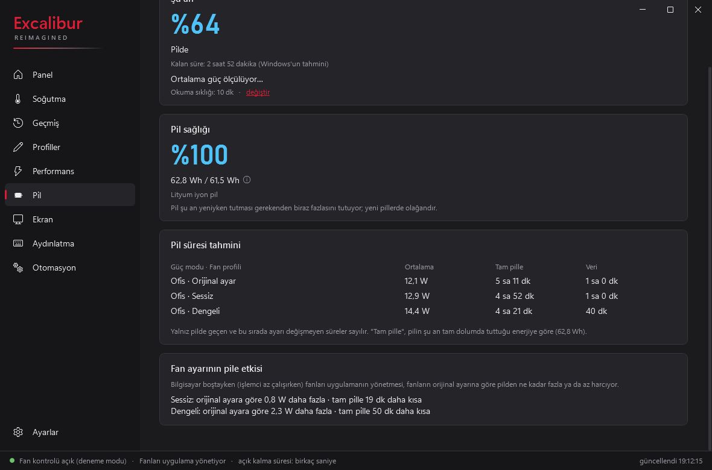

<div align="center">


# Excalibur Reimagined

**Casper Excalibur G870 için hafif, hızlı ve açık kaynaklı Control Center alternatifi.**

[](https://github.com/soldsawn/ExcaliburReimagined/releases/latest)
[](#)
[](LICENSE)

[Özellikler](#özellikler) • [Kurulum](#kurulum) • [Teknik Detaylar](#teknik-detaylar-ve-güvenlik) • [English](#english)

</div>

> [!WARNING]
> **⚠️ Dikkat**
> Bu uygulama, dizüstü bilgisayarınızın gömülü denetleyicisine (EC) doğrudan yazar. Asıl olarak **Casper Excalibur G870 (EC sürümü `P008B0`, BIOS CQ141)** üzerinde geliştirilip test edilmiştir. Farklı bir model veya EC sürümünde fanları önce yalnızca **izler**; fan kontrolü ancak sizin onayınızla yapılan kısa bir denemeden geçerse açılır (bkz. [Diğer modeller](#diğer-modeller)). 
> *Kullanım tamamen sizin sorumluluğunuzdadır. Bu projenin Casper veya Excalibur markasıyla resmî bir bağı yoktur.*

## 💡 Neden Excalibur Reimagined?

Orijinal Excalibur Control Center bazen yavaş açılır, arka planda gereksiz kaynak tüketir veya fan eğrilerini tam olarak yansıtmaz. **Excalibur Reimagined**, donanım katmanıyla doğrudan iletişim kurarak fanları ve güç modlarını pürüzsüzce yönetir. Kendiliğinden internete bağlanmaz, veri toplamaz, arka planda sessizce işini yapar.

<p align="center">
  
  
</p>
<p align="center">
  
  
</p>
<p align="center">
  
</p>
<sub>*Ekran görüntüleri uygulamanın deneme modundan alınmıştır; Pil sayfasındaki ölçümler örnek veridir.*</sub>

<a id="özellikler"></a>
## ✨ Özellikler

- 🌀 **Gelişmiş Fan Kontrolü:** Sessiz, Dengeli ve Performans profilleri. İşlemci (CPU) ve ekran kartı (GPU) fanlarını ayrı ayrı yönetme imkânı.
- 📈 **Özel Fan Eğrileri:** Kendi profilinizi oluşturun, grafik üzerinde noktaları sürükleyerek istediğiniz sıcaklığa istediğiniz fan hızını atayın.
- ⚡ **Güç ve Performans Modları:** Ofis, Oyun ve Yüksek Performans modlarıyla donanımınızın gücünü belirleyin; Panel'de fan profilinin hemen yanında. Her modun işlemci ve ekran kartı sınırı sizin bilgisayarınızda ölçülerek gösterilir (G870'te Ofis 35/75 W, Oyun 45/85 W, Yüksek Performans 55/100 W). İsterseniz her mod (ve pil) için Windows güç planı ve Windows güç modu da birlikte değişir (Ayarlar, varsayılan kapalı).
- 🔥 **İşlemci ve Ekran Kartı Güç Sınırı:** İşlemcinin uzun ve kısa süreli güç sınırını, ekran kartının da en yüksek gücünü (30 W'tan güç modunun sınırına kadar) güç modunun altına indirerek daha serin ve sessiz çalışma. Ekran kartı sınırı, kartın hızı birkaç saniyede bir ayarlanarak tutulur (G870'te 1500 MHz'de oyun 100 W yerine 40 W çekti, kart 82 °C yerine 62 °C'de kaldı). Performans sayfasında işlemcinin ve ekran kartının anlık çektiği güç de görünür.
- 🔋 **Pil Sayfası:** Pil sağlığı (tam dolum / ilk günkü kapasite), şarj durumu ve kalan süre; pildeyken son dakikaların ortalama tüketimi; güç modu ve fan profiline göre "tam pille ne kadar gider" tablosu ve fan ayarının pile etkisi. Pil, denetleyiciye yük olmasın diye seyrek okunur (varsayılan 10 dakikada bir, şarjdayken hiç); kayıtlar bilgisayarınızda 30 gün tutulur.
- ⌨️ **Klavye Işığı:** Üç bölge için renk, parlaklık ve efekt; belirli bir süre boşta kalınca ışığı kapatma. Klavyedeki ışık tuşuyla yapılan değişiklikler de izlenir.
- 🔌 **Akıllı Otomasyon:** Şarj kablosu takıldığında veya çıkarıldığında belirlediğiniz güç modu, fan profili ve ekran yenileme hızı (Hz) otomatik olarak devreye girer.
- 🎮 **Program Kuralları:** Seçtiğiniz bir program ya da oyun açıkken kendi fan profili, güç modu ve işlemci sınırı devreye girer; kapanınca önceki ayarlar geri gelir.
- 📊 **Geçmiş ve İzleme:** Görev çubuğunda canlı sıcaklık takibi, hızlı kontrol paneli, ekran bildirimleri (OSD) ve bilgisayarınızda tutulan 7 günlük sıcaklık/fan geçmişi (15 dakikadan 7 güne kadar aralıklar).
- 🔄 **Güncelleme Denetimi:** Ayarlar'daki düğmeye basınca GitHub'da yeni sürüm olup olmadığına bakar. Kendiliğinden internete bağlanmaz, veri göndermez, kendi kendine indirmez.

> **🛠️ Planlanan Özellikler:** Görünüm kişiselleştirme, klavye kısayolları ve İngilizce dil seçeneği.

<a id="diğer-modeller"></a>
### 🧪 Diğer Modeller ve EC Sürümleri

**Denenen cihazlar:**

| Model | BIOS | Fan yazılımı (EC) | Sonuç | Fanlar nasıl yönetiliyor |
|---|---|---|---|---|
| Casper Excalibur G870 | CQ141 | `P008B0` | Geliştirildiği cihaz, tüm özellikler | doğrudan EC |
| Casper Excalibur G870 | CP211 | `P009C0` | Deneme geçti (iki fan da uydu) | BIOS fan komutu (WMI) |
| Casper Excalibur G870 | CQ131 | `P007B0` | Deneme geçti (iki fan da uydu) | doğrudan EC |
| Casper Excalibur G770 | CP221 | `P003K0` | Deneme geçti (iki fan da uydu) | doğrudan EC |

Listede olmayan bir cihazda denediyseniz sonucu bir **Issue** ile paylaşabilirsiniz (bkz. [Katkıda Bulunma](#katkıda-bulunma)).

Uygulama açılışta dizüstünün fan yazılımı (EC) sürümünü okur:
- **`P008B0` (G870):** doğrudan fan kontrolü.
- **Bilinmeyen bir sürüm:** fanlar yalnızca izlenir. Panelde onay isteyen kısa bir deneme başlatılabilir: uygulama fanlara kısa süre bir hız yazar ve fanların gerçekten uyup uymadığına bakar. Önce BIOS'un kendi fan komutu (WMI) denenir; fanlar buna uyarsa o bilgisayarda fanlar hep BIOS üzerinden yönetilir ve denetleyiciye (EC) doğrudan hiç yazılmaz. Uymazsa doğrudan EC denenir. Fanlar uyarsa o sürüm o bilgisayar için açılır; uymazsa fanlar hemen dizüstünün kendi ayarına bırakılır. Hangi yolun kullanıldığı Soğutma sayfasında ve Ayarlar > Hakkında'da yazar; "Bilgileri kopyala" ile denemenin sonucu paylaşılabilir.
- **Başka bir bilgisayarda denemesi geçmiş sürümler** tek tıkla "kısa bir ayar" olarak sunulur: şu an **`P003K0`** (G770, BIOS CP221), **`P009C0`** (G870, BIOS CP211) ve **`P007B0`** (G870, BIOS CQ131).
- Her fanın yüzde başına devri kullanım sırasında öğrenilir. G870 dışındaki modeller deneme sonrası dizüstünün kendi fan ayarıyla başlar; G870 fan eğrileri bu modellerde gereğinden gürültülü olabilir.

---
<a id="kurulum"></a>
## 🚀 Kurulum

Henüz tek tıklamalı bir kurulum dosyası (`.exe`) bulunmamaktadır. Kurulumu kod üzerinden birkaç saniyede yapabilirsiniz:

### Gereksinimler
- Windows 11 ve Casper Excalibur G870
- [.NET 9 Runtime ve Windows Desktop Runtime](https://dotnet.microsoft.com/download/dotnet/9.0)
- [PawnIO](https://pawnio.eu) sürücüsü: Fan servisinin donanıma (EC) güvenle erişmesini sağlayan, imzalı bir sürücüdür. Kurulum betiği PawnIO'yu **kendisi kurmaz**; yoksa kurulumu durdurur. Önce yönetici PowerShell'de şunu çalıştırın (ya da resmî siteden indirip kurun):

```powershell
winget install namazso.PawnIO
```

### Adımlar

1. Başlat menüsüne sağ tıklayıp **Terminal (Yönetici)** veya **PowerShell (Yönetici)** seçeneğini açın.
2. Aşağıdaki komutları sırasıyla kopyalayıp yapıştırın ve Enter'a basın:

```powershell
# 1. Projeyi bilgisayarınıza indirin
git clone https://github.com/soldsawn/ExcaliburReimagined.git
cd ExcaliburReimagined

# 2. PawnIO'nun EC modülünü (LpcACPIEC.bin) indirin (sürücü değil, doğrulanarak indirilen küçük bir dosya)
powershell -ExecutionPolicy Bypass -File tools\scripts\get-pawnio-module.ps1

# 3. Servisleri kurun ve başlatın
powershell -ExecutionPolicy Bypass -File tools\scripts\install-fan.ps1
```

> **PawnIO sorun giderme:** Kurulum "PawnIO is not installed" hatası verirse yukarıdaki `winget` komutunu çalıştırıp kurulumu yeniden başlatın. Servis "needs administrator rights (PawnIO)" derse yönetici olarak çalıştırılmamıştır; kurulum servisleri zaten yönetici (SYSTEM) hesabıyla kurar.

> **Not:** Kurulum, eğer sisteminizde eski bir NoteBook FanControl (`NbfcService`) varsa çakışmayı önlemek için onu geçici olarak devre dışı bırakır. Kaldırma işleminde eski hâline geri döndürür. Uygulamayı kaldırmak isterseniz aynı klasörde `powershell -ExecutionPolicy Bypass -File tools\scripts\uninstall-fan.ps1` komutunu çalıştırmanız yeterlidir.

---
<a id="teknik-detaylar-ve-güvenlik"></a>
## ⚙️ Teknik Detaylar ve Güvenlik (Geliştiriciler İçin)

Fan kontrolü riskli bir işlemdir. Bu yüzden sistem, donanımınızı korumak için katı kurallarla tasarlandı:

### Güvenlik Tasarımı
- **Donanımsal Alt Sınırlar:** Fan hızı asla %25'in altına inemez (fanları BIOS üzerinden yönetilen bilgisayarlarda %30).
- **Isı Kalkanı:** Profiliniz ne olursa olsun; sıcaklık 3 saniye boyunca 70°C'nin üstünde kalırsa fanlar en az %80, 78°C'nin üstünde kalırsa en az %90 hızda çalışır. CPU veya GPU 80°C'nin üstünde 3 saniye kalırsa (ya da iki ölçüm üst üste 92°C'yi geçerse) fanlar beklemeden **%100**'e çıkar.
- **Açılışta Sakin Başlangıç:** Windows açılırken işlemci birkaç saniyeliğine 80-97°C'ye çıkar; fanlar her açılışta bunun için tam hıza çıkmasın diye servis başladıktan (ya da uykudan uyandıktan) sonraki ilk 60 saniye yalnız süren sıcaklığa bakılır: eğri ve alt sınırlar son 10 saniyenin en düşük sıcaklığını görür, fanlar 90°C 6 saniye sürerse %100'e çıkar.
- **Bekçi (Guardian) Servisi:** Ana fan servisi çöker veya kilitlenirse, yedek servis anında müdahale ederek fan kontrolünü dizüstü bilgisayarın orijinal yazılımına (EC Otomatik) geri devreder.
- **Hata Toleransı:** EC (Embedded Controller) okuması doğrulanamazsa, bilgisayar uyku moduna geçerse veya uygulamadan "Çıkış" yaparsanız kontrol tamamen orijinal donanım ayarlarına bırakılır. Eğer bilgisayar kilitlenirse, güç tuşuna 15-30 saniye basılı tutmak EC'yi sıfırlar.

### Mimari Nasıl Çalışıyor?
Uygulama 3 ana bileşenden oluşur:
1. `ExcaliburFan` *(Hizmet)*: Arka planda donanıma PawnIO üzerinden erişen, fan döngülerini ve güvenlik kurallarını işleten çekirdek servis.
2. `ExcaliburFanGuardian` *(Hizmet)*: Çekirdek servisi izleyen gözetmen.
3. `ExcaliburReimagined.exe` *(Arayüz)*: Sadece bir kontrolcüdür. Donanıma dokunmaz, yerel adlandırılmış boru (named pipe) üzerinden servise komut gönderir.

Geliştiriciler, test yapmak için donanıma dokunmayan simülasyon modunu kullanabilir: `ExcaliburFanService.exe --simulate` (`--on-battery` pildeymiş gibi, `--ec <sürüm>` başka bir EC sürümüymüş gibi, `--wmi-fans` BIOS fan komutunu destekleyen bir bilgisayarmış gibi davranır).

### EC ile Daha Az Konuşmak
EC, Windows'un kendi pil ve sıcaklık okumalarıyla paylaşılır; iki taraf aynı anda konuşursa Windows olay günlüğünde ACPI 13/15 uyarıları görülebilir. Bu yüzden servis EC'yi gereksiz yere meşgul etmez: işlemci sıcaklığı doğrudan işlemciden okunur; yazılan fan hızları geri okunmaz, fan devriyle doğrulanır (EC yalnız bir fan hedefine uymazsa okunur); koruma hizmeti sensörleri ayrıca okumaz, ana servisten alır; denetleyici kendi işini yaparken (ışık tuşu, şarj kablosu) okumalar bekletilir; pil seyrek okunur. BIOS fan komutunu destekleyen bilgisayarlarda fanlar EC'ye hiç doğrudan yazılmaz. Yavaş çağrılar ve uyarı anları `C:\ProgramData\ExcaliburReimagined\logs` günlüğüne yazılır.

<a id="katkıda-bulunma"></a>
## 🤝 Katkıda Bulunma
Başka bir donanım modelinde veya BIOS sürümünde test etmek isterseniz, lütfen bir **Issue** açarak model, EC ve BIOS sürümünüzü ve denemenin sonucunu belirtin. Okuma/yazma doğrulaması yapılmadan yeni cihazlar için fan kontrolü kilidi açılmaz; birkaç farklı bilgisayarda geçen sürümler listeye eklenir.

## 📄 Lisans ve Sorumluluk Reddi
[MIT Lisansı](LICENSE) ile sunulmaktadır. (Donanım erişimi için kurulan PawnIO modülleri LGPL-2.1 lisanslıdır ve resmi kaynaktan çekilir). Donanım bileşenlerine yapılan müdahaleler cihazı garanti dışı bırakabilir veya ısınma sorunlarına yol açabilir. Kullanımdan doğacak tüm sorumluluk kullanıcıya aittir.

---

<a id="english"></a>
## 🇬🇧 Excalibur Reimagined (English)

A lightweight, open-source, and bloat-free replacement for Casper's Excalibur Control Center, built specifically for the **Casper Excalibur G870** laptop (Windows 11).

> [!WARNING]
> **`v0.1.6`.** This application writes directly to the laptop's embedded controller (EC). It was built and tested on **EC version `P008B0`, BIOS CQ141**. On unknown versions it starts in monitor-only mode; fan control is enabled only after a short trial you approve (the fans must follow the targets written). The trial first tries the BIOS's own fan command (WMI 0x0205); if the fans follow it, they are always set that way and the EC is never written directly. Otherwise it tries the EC registers. Trials have passed on `P003K0` (G770), `P009C0` and `P007B0` (G870), which are offered as a one-click calibration. Use at your own risk.

**Tested devices:** G870 · BIOS CQ141 · EC `P008B0` (developed on, fans through the EC) · G870 · BIOS CP211 · EC `P009C0` (trial passed, fans through the BIOS/WMI) · G870 · BIOS CQ131 · EC `P007B0` (trial passed, fans through the EC) · G770 · BIOS CP221 · EC `P003K0` (trial passed, fans through the EC).

**Features:**
- Custom fan curves with separate CPU/GPU targets.
- Hardware power modes (each mode's CPU and GPU limits measured on your laptop; 35/75, 45/85, 55/100 W on the G870), your own CPU power limits and a GPU power limit (held by adjusting the GPU clock every few seconds); optionally the Windows power plan and power mode follow each mode (off by default).
- Battery page: health, charge and time left, average draw on battery, a "full battery lasts" table per power mode and fan profile, and the fan profile's cost while idle. The battery is read sparingly (every 10 minutes by default, never while charging).
- Keyboard light: three-zone colour, brightness, effects and idle-off.
- Smart automation based on AC/Battery status (auto-switch profiles and refresh rates).
- Program rules: a fan profile, power mode and CPU limit while a chosen program or game runs.
- Update check on demand (Settings): reads the GitHub release list only when you press the button.
- Zero telemetry, low background resource usage, and local temperature history.

**Safety First:**
Hardcoded limits ensure fans never go below 25% (30% when they are set through the BIOS). Automatic overrides kick in when temperatures stay above 70°C (80% fan) or 78°C (90% fan) for 3 seconds, and force 100% fan speed above 80°C for 3 seconds (or two readings above 92°C). For the first 60 seconds after a start or wake only lasting heat counts (Windows starting up spikes the CPU to 80-97°C): 100% after 90°C for 6 seconds. A background "Guardian" service constantly monitors the main process; if it crashes, fan control is immediately returned to the factory BIOS.

**Installation (Elevated PowerShell):**
```powershell
winget install namazso.PawnIO   # the PawnIO driver (https://pawnio.eu); the installer below does not install it
powershell -ExecutionPolicy Bypass -File tools\scripts\get-pawnio-module.ps1
powershell -ExecutionPolicy Bypass -File tools\scripts\install-fan.ps1
```
*(Requires the .NET 9 Runtimes and the PawnIO driver. `get-pawnio-module.ps1` only downloads the small EC module, not the driver itself.)*
